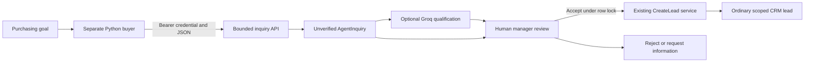
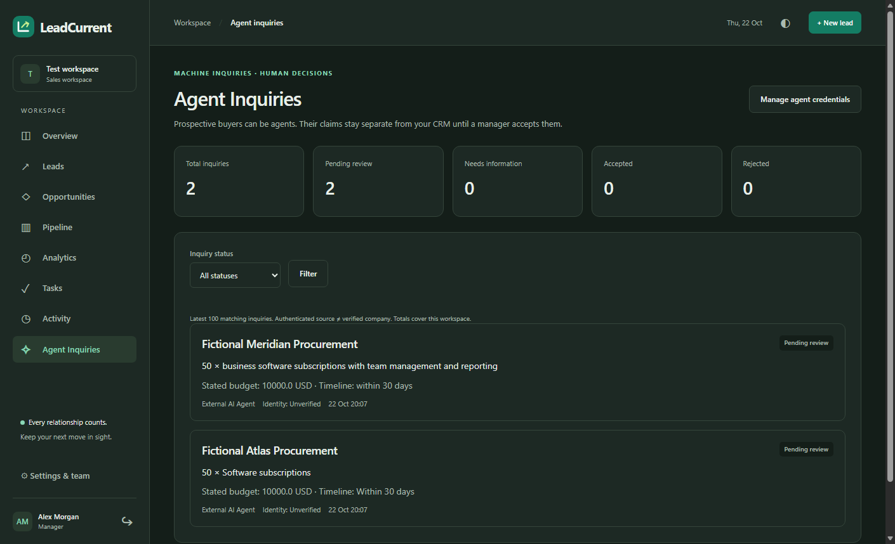
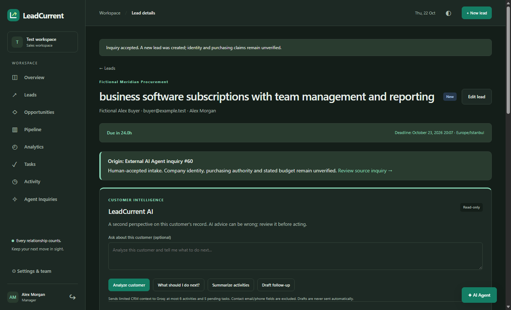

# Phase 3 — AI agent as a prospective customer

22 October 2026. **Local review only.** Branch `phase3/agent-customer` starts at `e8c3e0da485994567c948e40fbeb4cc32a4dc312`. Main was preserved. No Phase 3 push, remote CI, Railway deployment, production configuration change or production acceptance is claimed. Phase 2's previously reported Railway platform block remains pending; see the preserved [publication report](PHASE2_PUBLICATION.md).

LeadCurrent now receives an actual authenticated purchasing inquiry from a separate Python agent, keeps its claims outside the ordinary CRM, and lets a human manager decide whether to create a lead. Authenticating a credential proves possession of a workspace capability; it does not verify the claimed company, budget or purchasing authority. This implements the professor's question, “What if your customer were an AI agent?” The source of that problem is the user's project brief, preserved verbatim in [CHALLENGE_LOG.md](../CHALLENGE_LOG.md). No customer interviews, market exclusivity, competitor shortcomings or financial savings were measured.

## Architecture and authority



| Actor | Permitted actions | Boundary |
| --- | --- | --- |
| Agent credential | Submit/replay inquiries in its issuing workspace | No lead, opportunity, review, query or purchase authority |
| Signed-in salesperson | Read own-workspace inbox/details/source lead | No credential management, qualification or decisions |
| Signed-in manager | Issue/revoke credentials, explicitly analyze and review own-workspace inquiries | Browser CSRF and mandatory-password protections remain |
| Groq | Produce bounded structured interpretation or a buyer action proposal | No direct database, network destination, shell or commercial authority |

Phase 1 services, Phase 2 Copilot/Page Agent implementation, authentication algorithms, ordinary sales workflow services and database connection configuration were preserved. Page Agent's existing route allowlist excludes the new inbox and credential pages; it cannot read the displayed secret or submit an approval there. New human review actions are ordinary protected Rails forms.

## Additive persistence and transitions

Migration [20261022000100_create_agent_intake.rb](../db/migrate/20261022000100_create_agent_intake.rb) adds `agent_credentials` and `agent_inquiries`, plus two composite unique indexes on existing users/leads to support organization-aware foreign keys. It does not update or remove existing customer rows. Rails regenerated `db/schema.rb` after applying the migration. Upgrade from the previous three-migration schema passed on the test database; all four migrations also passed on a fresh disposable production container database.

Credentials contain issuer, organization, public identifier, SHA-256 token digest, fixed `inquiries:create` scope, optional expiration and revocation time. The random secret has 256 bits of entropy. Only its digest is stored. Secret comparisons use constant-time comparison for equal-length digests after identifier lookup; the entire HTTP request is not claimed to have constant timing. The manager sees the full token once in a no-store/no-Turbo-cache response; Stimulus clears it before caching or leaving. There is no recover-secret route. Revoke is irreversible and audited.

Inquiries contain bounded submitted fields, immutable original JSON, credential and organization, submission timestamp, idempotency/payload digests, status, reviewer/time/reason and optional accepted lead. PostgreSQL enforces credential-scoped idempotency uniqueness, accepted-lead uniqueness, same-organization credential/reviewer/lead references, allowed statuses, review evidence and numeric bounds. Model checks also reject source/tenant mutation. Direct SQL constraint tests and separate-connection concurrency tests passed.

```text
pending_review -> needs_information -> accepted OR rejected
pending_review --------------------> accepted OR rejected
accepted / rejected -> no further decision
```

Requesting information records an internal human decision; it sends no email. Source payloads cannot be edited. If contact details were omitted, obtain them outside this demo and submit a new complete inquiry with a new idempotency key; reject or retain the original with an explanatory reason. The implementation does not pretend to have an outbound conversation or inquiry-update API.

Acceptance requires the saved contact name/email and an existing owner from the same workspace. `ReviewAgentInquiry` locks and rechecks the inquiry, calls the unchanged `CreateLead`, associates the new lead and records real human audit events inside the same transaction. The normal deadline service starts the 24-hour clock at lead creation, even if the inquiry is days old. It creates no completed contact, activity, task, opportunity, won sale or purchase. Real `CreateLead` validation failure rolls everything back. A second approval cannot create another lead. Reject retains the original record without creating a customer. API submission provenance is the credential/timestamp/source record; it does not fabricate a human actor in the existing human-only audit schema.

## API contract

```http
POST /api/v1/agent_inquiries
Authorization: Bearer [REDACTED]
Content-Type: application/json
Idempotency-Key: fictional-demo-request-0001
```

| Field | Rule |
| --- | --- |
| `company_name` | Required nonblank string, at most 150 characters |
| `product_or_service` | Required nonblank string, at most 200 characters |
| `message` | Required nonblank string, at most 2,000 characters |
| `contact_name`, `contact_email` | Optional, at most 150/254 characters; supplied email must validate |
| `quantity` | Optional integer 1–1,000,000; booleans/decimal/string types rejected |
| `currency` | Optional USD, EUR or TRY |
| `stated_budget` | Optional nonnegative decimal, at most 12 integer digits and two decimals; currency required |
| `requirements`, `desired_timeline` | Optional strings, at most 3,000/200 characters |

Only these ten fields are accepted; `organization_id`, status, owner and all other unknown fields are rejected. The credential supplies the organization. Top-level JSON must be an object. Duplicate keys, malformed JSON, control characters, disallowed types, excessive nesting, recognizable embedded credential formats and payloads above **16,384 bytes** are rejected. The original valid parsed JSON is retained; normalized trimmed attributes support display/review. This is validation, not identity verification.

The idempotency header must be 16–100 ASCII letters/digits or `.`, `_`, `:`, `-`. Its digest and the authenticated credential form the durable identity. A credential row lock serializes submissions; the database unique index provides a second boundary. JSON key ordering is canonicalized for payload comparison. Whitespace inside string values, omitted versus explicit-null fields and numeric/string type changes remain distinct payloads. The same key and payload return the existing receipt; another payload returns 409. A final inquiry can be replayed for its current status without reopening or approving it. Revoked/expired credentials cannot replay.

```json
{"inquiry_id":60,"status":"pending_review","identity":"unverified","replayed":false}
```

The receipt above is an actual fictional test result, not a production record or a hardcoded API response. A first submission returns 201; replay returns 200 with `replayed:true`. Errors use fixed JSON codes/messages: 400 malformed JSON/key/query, 401 missing/invalid/revoked/expired bearer, 405 unsupported method, 409 conflicting idempotency payload, 413 oversized body, 415 non-JSON media, 422 invalid fields, 429 rate limit, 503 unexpected internal failure. No provider body, exception trace, customer contents or secret is echoed. Authentication errors include a Bearer challenge; 429 includes Retry-After.

`AgentInquiryIngress` bounds/reads this exact endpoint before Rails request logging/parameter parsing. Browser session cookies do not authorize its independent `ActionController::API` controller. No global CSRF exemption was added. Query strings are rejected. Request parameters and bearer credentials are concealed from Rails request logging; log-capture tests include unknown malicious fields. Filters also cover credential and inquiry fields on browser actions. Infrastructure request capture must likewise avoid body/Authorization logging.

Minute rate limits are **60/IP, 10/credential and 30/workspace**, stored in bounded process-local memory; stored IP keys are hashed. They are appropriate for this single-process demonstration, not a distributed quota. Existing Groq/account gates are reused for qualification. All such process-local limits need a shared implementation before multiple workers/replicas. No Redis/service was added for this university scope.

## Explicit Groq qualification

Managers click **Analyze with AI**. Only then does Rails reread the authorized saved inquiry and use the existing Groq transport with fixed **`openai/gpt-oss-20b`**. The API never invokes Groq automatically. Company/product and bounded request claims are supplied as untrusted data; contact identity fields, credential values, database identifiers and unrelated CRM records are omitted. Free text is redacted best-effort, not guaranteed anonymous.

The strict schema includes summary, potential opportunity, missing information, suggested next step, allowed evidence fields, actual human-review status and `claims_verified:false`. Local validation rejects wrong shapes, invented evidence, status mismatches, oversized results and explicit unsupported positive verification/acceptance claims; recognized credential content is redacted. AI interpretation remains fallible; a textual guard cannot prove every sentence factual. It is labeled separately, rendered escaped and never used as a workflow command. Analysis is ephemeral and not saved. Missing key, timeouts, 429 and invalid responses leave the inquiry accessible for manual review. There is no fabricated fallback or new model/provider.

The design follows the bearer possession model in [RFC 6750](https://www.rfc-editor.org/info/rfc6750/) and Rails' [security guide](https://guides.rubyonrails.org/security.html). Strict schema configuration was checked against Groq's [structured output documentation](https://console.groq.com/docs/structured-outputs) and [API reference](https://console.groq.com/docs/api-reference). Structured output improves shape reliability; it does not verify a business claim.

## External buyer and local commands

[Python client](../examples/purchasing_agent/client.py) uses only the standard library. Mode A prepares fixed fictional data without an LLM. Mode B really calls Groq with the purchasing goal, validates a fixed `submit_inquiry` / `request_information` action, checks supplied fictional identity and then lets trusted Python code make the Rails request. If information is requested, it stops without submission. The model receives neither credential and cannot choose URLs, execute code, read files, follow redirects, accept quotations or pay. TLS verification, response/request caps and timeouts remain enabled. The client uses no automatic retry or hardcoded successful AI fallback.

Allowlisted destinations are the existing production HTTPS origin (not used in this task), local `http://127.0.0.1:3100`, and `http://127.0.0.1:3170` for the isolated live verifier. Arbitrary hosts, user information, extra paths/query strings and redirects are rejected. Local HTTP is loopback-only; use HTTPS for remote traffic. See the runnable [Turkish demo](AGENT_CUSTOMER_DEMO_TR.md) and [client instructions](../examples/purchasing_agent/README.md).

For a preserved existing checkout, start its existing local PostgreSQL using the existing helper and apply only the additive migration:

```powershell
Set-Location D:\LeadCurrent
powershell -NoProfile -ExecutionPolicy Bypass -File bin/local-postgres.ps1 -Action start
bundle install
npm ci --ignore-scripts
npm run build
bundle exec rails db:migrate
$env:GROQ_API_KEY = [Environment]::GetEnvironmentVariable('GROQ_API_KEY', 'User')
$env:GROQ_MODEL = 'openai/gpt-oss-20b'
bundle exec rails server -b 127.0.0.1 -p 3100
```

If port 3100 already has this Rails server, reuse it. Never reset/drop/seed the working database. The earlier Phase 1 statement that AI needed no migration applies to Phase 1; Phase 3 requires this new migration. No database URL/port/user/password configuration was changed.

Normal checks require no live provider key:

```powershell
$env:GROQ_API_KEY = $null
$env:LEADCURRENT_LIVE_AGENT = $null
$env:LEADCURRENT_LIVE_AGENT_CUSTOMER = $null
bundle exec rails test
bundle exec rails test:system
python -m unittest discover -s examples/purchasing_agent/tests -v
bundle exec rails zeitwerk:check
bundle exec brakeman --no-pager --quiet
npm run build
```

Run production asset compilation separately from browser tests; restore the development manifest lookup afterwards using the existing build workflow. Docker builds it without host database access: `docker build -t leadcurrent:phase3-review .`. Do not run destructive database commands to reproduce checks.

Optional real acceptance, already performed once successfully; **do not repeatedly spend quota**:

```powershell
$env:GROQ_API_KEY = [Environment]::GetEnvironmentVariable('GROQ_API_KEY', 'User')
$env:LEADCURRENT_LIVE_AGENT_CUSTOMER = '1'
bundle exec ruby script/verify_agent_customer.rb
Remove-Item Env:LEADCURRENT_LIVE_AGENT_CUSTOMER
```

It refuses CI/production, runs the separate Python client against an isolated local Rails test server, uses fictional rollback fixtures and includes a conservative test-only quota pause. It does not modify development customers. Normal CI mocks provider transport and includes the seven Python tests; Phase 3 remote CI is **not run**, because nothing was pushed.

## Measured verification

| Check | Actual result on 22 October |
| --- | --- |
| Before changes: Rails | 139 tests / 1,820 assertions, seed 20008, PASS |
| Before changes: browser | 27 tests / 385 assertions, seed 38958, PASS |
| Final Rails | **164 tests / 2,108 assertions**, seed 17603, PASS; zero failures/errors/skips |
| Final browser | **29 tests / 436 assertions**, seed 9596, PASS; zero failures/errors/skips |
| Python client | **7 tests**, PASS, transport mocked |
| Zeitwerk / Brakeman 8.1.0 | PASS / zero warnings and errors |
| Node 22 locked install/build | PASS; npm audit at install reported zero advisories |
| Production asset compilation | PASS |
| Actual Linux production Docker build/startup | PASS; isolated PostgreSQL 17, four migrations, zero seeded users/leads |
| Container checks | `/up`/login/compiled official Page Agent HTTP 200; CSP without unsafe-eval; UID 1000; db/log/tmp writable; private/local paths absent |
| Existing development smoke | 12 checks PASS: login, lists/profiles, Phase 1 controls, Phase 2 panel, new protected pages and logout; no AI requests |
| Data preservation | Original nine application tables unchanged by row-content SHA-256 comparison; new tables empty in development |

Rails plus browser total **193 tests / 2,544 assertions**, excluding Python and opt-in live tests. Tests cover auth/revocation/expiration, tenant tampering, missing contact, parser/size/type/logging limits, CSRF and mandatory password, role access, idempotency/conflicts, direct database constraints, two independent submission/approval races, failed real CreateLead rollback, escaped malicious text, phone-width light/dark layout, once-visible secrets and AI invalid/unavailable responses. Existing sales, security, Copilot queries, official Page Agent navigation and unsaved-note tests remain in the full regression run.

### Actual real-provider demonstration

Two attempts are retained in [structured evidence](evidence/phase3-agent-customer-2026-10-22.json). At 17:06:00–17:06:06 UTC, deterministic submission/replay passed but the first real buyer call returned HTTP 403. It was **not** a successful Mode B or a quota diagnosis. The Python transport was given a truthful application User-Agent; the next run worked. This is an observed compatibility result, not proof of every 403's cause.

At **17:07:44–17:08:53 UTC**, the full real demonstration passed: **1 test / 48 assertions, seed 51631**, 69.31 seconds including a 60-second test-only quota pause. Manager UI issued a credential; a separate deterministic Python process received 201 then idempotent 200; a separate real Groq buyer generated and posted a new inquiry; the inbox showed it; actual saved-data Groq qualification left its status unchanged; human acceptance used CreateLead with a fresh 24-hour deadline and source link; real Phase 1 analyzed the lead; real Phase 2 found it with an authorized query. No purchase/contact was recorded. Fixtures rolled back. No production endpoint was contacted.

**Four successful real completions, 4,808 metered tokens**: buyer 837, qualification 786, Phase 1 1,063, Phase 2 2,122. Combined 4,086 prompt + 722 completion tokens. No 429 occurred in the passing run. The rejected 403 request has no reported token usage and is not silently counted as free. Financial cost, savings and human/agent development hours were not measured. No more live calls were made. Later local owner/reason validation and archive-scanning hardening passed normal tests; the successful live scenario was not repeated after those small guards.

These are actual screenshots from that fictional live run, visually reviewed, without credential-page captures:





## Threat review and remaining limits

| Threat | Implemented boundary / residual limit |
| --- | --- |
| Forged company / stolen token | Always unverified; token can only submit pending inquiries; revoke/expire; human independently checks authority |
| Cross-workspace access | Credential-derived tenant, scoped reads/owners, service rechecks and composite PostgreSQL foreign keys |
| Replay / approval races | Durable credential-key unique index and payload digest; row locks, atomic CreateLead, final decisions and unique accepted lead |
| Injection / malicious input | Fixed schemas/actions, bounded data, escaped views, no AI write or arbitrary SQL/URL/code tool; prose still requires human review |
| Flooding | Early body bound, per-IP/credential/workspace limits, no automatic AI; shared limiter required for multiple processes |
| Credential disclosure | Digest-only storage, once-visible no-cache page, body concealed before logging, secret filters and source/archive scan |
| Sensitive information | Access limited to workspace members; contacts omitted from qualification, free-text redaction is imperfect; no claim of full anonymity |

The recent list is limited to 100 records, without pagination. There is no public self-registration, OAuth/identity attestation, inquiry polling API, outbound email, update-in-place inquiry workflow, quotation acceptance or payment. Company/contact claims remain unverified even after acceptance; acceptance authorizes an internal lead, not a verified corporate identity. Provider availability/quota and AI factual reliability remain limitations. No GPU, local foundation model, paid service dependency, new provider or fallback model was introduced.

## Source review, commit and later release

New code is concentrated in credential/inquiry models/controllers/views, `agent_intake` services, `ReviewAgentInquiry`, the narrow ingress middleware, one migration, the Python example, opt-in live script and targeted tests. Existing-file changes are limited to organization associations, scoped lead source display, navigation/styles, routes/log filters, Python CI/ignore rules, source scanner signatures and documentation. The final reviewed diff, exact local commit SHA, archive path/hash and independent archive verification are delivered with the local release report; they are not fabricated inside a self-referencing commit. [Machine evidence](evidence/phase3-agent-customer-2026-10-22.json) records the dated test observations.

The packaging helper checks actual local secret matches, credential signatures, forbidden paths and every ZIP file. It only packages a clean committed Git tree. Two existing Gitleaks generic-pattern findings (a public commit hash and a synthetic password regression string) must be individually confirmed unchanged rather than hiding all findings. Preserve earlier evidence, local key and database. No `.local`, `.git`, master key, environment secrets, logs, databases, node_modules or review archives belong in the source ZIP.

**Before release:** user reviews this local branch/ZIP and explicitly approves publication; compare current GitHub main, merge normally without resetting existing work, push the approved commit and require its exact remote CI (including new Python tests) to pass. Back up the existing production database through the established operation before migration. When Railway becomes available, deploy the approved existing service/commit using its existing variables and Dockerfile; no new service or variable changes were made here. Its existing entrypoint runs additive migrations. Verify `/up`, login/CSP, built Page Agent assets and ordinary workflows before a controlled fictional agent inquiry, manager qualification/approval and Phase 1/2 acceptance. Use a short-lived dedicated credential, revoke it afterward, and apply a reviewed data cleanup policy. Never reset/seed production or call a deployment successful before the exact deployment and production acceptance are observed. **GitHub Phase 3 publication, Railway deployment and production acceptance remain pending.**


## Phase 3.1 developer integration documentation

23 October local-only follow-up preserves this implementation and adds a public Integration Center and downloadable OpenAPI description. [Integration guide, model-independent API requirements, deterministic commands and short Turkish presentation](AGENT_INTEGRATION_GUIDE.md). Local page: http://127.0.0.1:3100/agent-integrations; spec download: http://127.0.0.1:3100/api-docs/agent-inquiries/openapi.yaml. No Phase3.1 migration/provider/production change, push or deployment. Earlier results above remain historical; [Phase3.1 evidence](evidence/phase31-integration-center-2026-10-23.json) records current checks.
