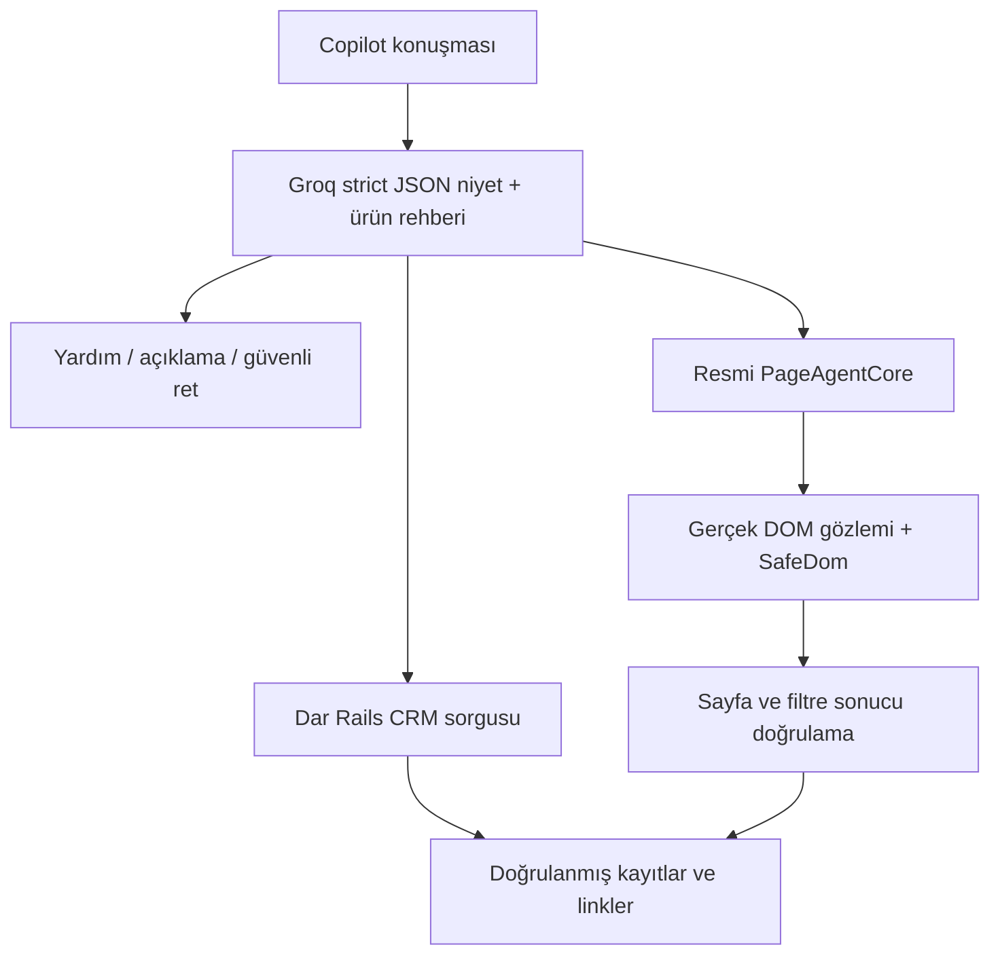

# LeadCurrent Phase 2.1 — Konuşmalı AI Copilot

**21 Ekim finalizasyonu:** ekip/CRM özeti, sorguya özel doğrulama, logout temizliği ve panel iyileştirmeleri [güncel Phase 2 final raporundadır](COPILOT_PHASE2_FINAL_TR.md). Aşağıdaki 20 Ekim sonuçları tarihsel kanıttır.

20 Ekim 2026, yerel `phase2/page-agent`. HEAD `65bcd55cfbd55ca1d91691bb1d873e0560fd76b0`; Phase 2 başlangıçta zaten commit edilmemişti. Phase 2.1 başlangıcının gerçek kaynak hash snapshot'ı ayrıca alındı. **Push ve Railway deploy yapılmaz.** Önceki Phase 1/2 kanıtları korunur; yeni bir commit veya üretim başarısı iddia edilmez.

## Sorun ve mimari karar

İlk panel bütün metni zorunlu `AgentOutput` function çağrısına gönderiyordu. Genel yardım için konuşma yolu yoktu. `done` aktivitesi kütüphanede genel “Task completed” döndürür; uygulama modelin final metnini kabul ediyor, filtreye uyan kayıtları sunucuda kontrol etmiyordu. Bu nedenle gerçek navigasyon doğru olsa bile kullanıcı yararlı isim/sayı/deadline cevabı alamıyordu. Kullanıcının önceki hata gövdesi mevcut olmadığından o tek hatanın ham üretimi hakkında tahmin yapılmaz. Yeni canlı denemede gerçek HTTP 400 `tool_use_failed` ayrıca yakalandı; tool şeması aşağıdaki gibi daraltıldı.

Resmî `@page-agent/core` ve `@page-agent/page-controller` **1.12.4** korunur. Rails/Hotwire/importmap/Propshaft mimarisi değiştirilmez. Konuşma ve tarayıcı eylemi ayrı protokollerdir:



`Copilot::Planner` aynı server-only Groq bağlantısında ayrı strict JSON yanıtı kullanır, tool kullanmaz. Niyetler `answer_question`, `read_crm_data`, `show_crm_data`, `page_action`, `clarify`, `unsupported_action` olarak doğrulanır. Doğal dil/spelling/follow-up yorumunu model yapar; Ruby/JS içinde kelimeyi URL'ye çeviren sınıflandırma yoktur. Birbiriyle çelişebilen “data intent + navigate boolean” kararları ilk denemelerde hataya yol açtı; eylem kararı artık tek niyetten türetilir. `show_crm_data` hem sorgu hem gerçek UI etkileşimidir, `read_crm_data` yalnız doğrulanmış cevaptır.

Ürün rehberi gerçek lead/opportunity akışı, tasks, güvenlik sayfası ve Phase 1 AI sınırlarından yazıldı. Rehber cevabı model açıklaması olarak etiketlenir; CRM gerçeği veya gerçekleşmiş eylem sayılmaz. Ayarlar/parola için yalnız sabit, yetkili kullanıcının kendisinin tıklayacağı link ve talimat sunulur. Gizli sayfa DOM'u modele açılmaz.

## Gerçek CRM verisi

`Copilot::CrmReader` yalnız açık query türlerini çalıştırır: overdue first-contact lead, gün sonuna kadar ilk temas gerektiren lead, pending/today/overdue task, lead status breakdown, mevcut stage'e göre opportunity ve değişmemiş `NextBestAction` öncelikleri. SQL, model adı veya serbest kayıt ID'si modelden alınmaz. Bütün sorgular `WorkspaceAccess.scope` ile başlar; “my” sorgusu owner=current_user filtresi uygular, workspace sorgusu mevcut okuma yetkisini korur. Arama escaped ILIKE ile title/company alanlarına uygulanır; task araması yalnız title içindir.

Sayılar gerçek `count`, isim/status/deadline ve linkler authorized PostgreSQL kayıtlarından gelir. En çok 10 satır, NBA için en çok 8 öneri döner; toplam sayı ve gösterilen sınırlı liste ayrılır. Modelin data yanıtındaki uydurma sayı/isimler kullanılmaz. Sıfır sonuç açıkça söylenir; DB hatası “doğrulayamadım” olur. Tarihler kullanıcının saat dilimindedir. NBA yalnız resmî servisin uygun gördüğü değiştirilebilir kayıtlara öneri verebilir; “workspace” sözcüğü bu servisin sahiplik kuralını genişletmez.

`show_crm_data` için doğrulanmış query tanımı sıradan bir Page Agent talimatına dönüştürülür; gizli endpoint/ID veya otomatik URL navigasyonu değildir. PageAgentCore hâlâ gerçek DOM'u gözler, model görünür kontrol token'ını seçer, SafeDom gerçek linki/GET formunu çalıştırır. Tasks'a kullanıcıların da kullanabildiği Owner filtresi eklendi. “Bugün ilk temas gereken” query'sinin tam eşdeğer UI filtresi yoktur; bu durumda sadece gerçek veri cevabı verilir, filtre uygulanmış gibi söylenmez.

`/copilot/outcome`, tek kullanımlık server-held planı tekrar kapsamlandırır ve gerçek current path/submitted query/owner/status/search/deadline filtresini kontrol eder. `done` tek başına başarı kanıtı değildir. Not için tarayıcı mevcut body/kind=note/boş follow-up alanını ayrıca kontrol eder; server unsaved DOM'u bağımsız göremediği için bu sonuç **browser observation** olarak etiketlenir. Kullanıcı ayrı Save action tıklamasıyla onaylar. Hiçbir agent aracı CRM submit yapamaz.

## Güvenlik ve konuşma ömrü

Yeni `/copilot/messages` ve `/copilot/outcome` aynı session, zorunlu parola değişimi, CSRF ve no-store kontrollerini kullanır. JSON gövdesi 4KB, kullanıcı metni 600 karakter, model plan input'u 12KB ve completion 600 token ile sınırlıdır. Serbest provider URL/key/model/SQL/JS seçeneği kabul edilmez. Page Agent proxy'sinin 28KB/16KB/512-token sınırları korunur. TLS, 3/15/5 saniye bağlantı/okuma/yazma ve 25 saniye toplam HTTP timeout sürer.

`AgentOutput` için server canonical tool şeması artık `strict:true`, yalnız izinli tek `action` nesnesidir; gereksiz reflection alanları modelden istenmez. Bu, serbest tool veya JS eklemek değildir. İsim/ID/argüman şekli ayrıca yerelde doğrulanır. [Groq tool örneği](https://console.groq.com/docs/reasoning) strict function tanımını, [structured-output belgesi](https://console.groq.com/docs/structured-outputs) 20b strict JSON desteğini gösterir. Strict JSON konuşma yolu ile tool yolu birbirine karıştırılmaz.

Konuşma server MemoryStore'da toplam 2MB ile sınırlı, dört önceki turn, 10 dakika idle / 30 dakika mutlak ömürlüdür. organization/user/DB login session'a bağlıdır. Pending plan beş dakika/tek kullanımlıktır. Browser yalnız conversation ID ve en çok 16 mesaj taşır; chat localStorage/sessionStorage'a yazılmaz. Tam reload/disconnect/pagehide temizler. Hata/Stop sırasında konuşma korunur; New chat sıfırlar. Çok worker/instance öncesi ortak store gerekir; eviction/restart konuşmayı bitirebilir.

Modelin planner girdisine yalnız bounded kullanıcı metni, önceki niyet tanımları ve izinli sayfa yolu gider; sorgudan dönen müşteri satırları/geçmişleri gitmez. Page Agent gözlemi önceki SafeDom daraltmasını sürdürür. Notes, contact email/telefon, parola/settings ve mevcut not metni dışlanır. Serbest başlık/görev/arama metni yine hassas bilgi içerebilir; maskeleme kusursuz anonimlik değildir. Model HTML'i execute edilmez; cevaplar/aktivite/satırlar `textContent` ile gösterilir. CSP gevşetilmez ve Phase 1 kaynakları değişmez.

## Gecikme ve kota

İlk Phase 2'deki 25 saniye sabit bekleme resmî kütüphanenin gerekliliği değildi; free-tier önlemiydi. İncelenen [Groq rate-limit belgesinde](https://console.groq.com/docs/rate-limits) 20b base free limitleri 30 RPM, 1.000 RPD, 8.000 TPM / 200.000 TPD olarak görünür; gerçek hesap limitleri farklı olabilir ve bütün Groq organizasyonunda paylaşılır. Üstteki rehber bunları hesap garantisi saymaz.

Yeni taban bekleme 400ms'dir. Server yalnız sayısal remaining-token/reset ve Retry-After header'larını kullanarak konservatif input-byte/3 + completion bütçesi ayırır. Düşük token bütçesi/shared cooldown 429 + güvenli Retry-After döndürür. Browser en çok **bir** retry yapar, yalnız 1–60 saniyelik beklemeyi uygular; Stop bunu iptal eder. Timeout, invalid tool veya malformed response otomatik tekrar edilmez. Uzun/daily kota beklemesi kullanıcıya bırakılır.

Önceki 8/account, 12/workspace, ortak provider sayacında 16 agent isteği/dakika ve 300/600/800 günlük TTL bütçeleri korunur; planner çağrıları da bunları tüketir. Phase 1 ortak provider sayacını kendi 20 sınırına kadar kullanabilir. Header olmadığı/başka process ya da uygulama aynı hesabı kullandığı durumlarda kesin TPM garantisi yoktur; sağlayıcı yine 429 verebilir. Sahte testler gerçek gecikme veya API tasarrufu kanıtı değildir.

## Yerel kullanım ve kanıt

Node 22, mevcut Ruby/PostgreSQL gerekir; DB reset/seed yapmayın:

```powershell
cd D:\LeadCurrent
npm ci --ignore-scripts
npm run build
powershell -ExecutionPolicy Bypass -File bin/local-postgres.ps1 -Action start
$env:GROQ_API_KEY=[Environment]::GetEnvironmentVariable('GROQ_API_KEY','User')
bundle exec rails server -b 127.0.0.1 -p 3100
```

AI Agent girişini açın; panel başlığı **LeadCurrent AI Copilot** olur. “Tell me how can I use the system?”, “Which leads are late?”, “Show my late leads”, “Find Atlas Industries”, “Go to analytics”, “Prepare a follow-up note” veya “Mark this deal won” deneyin. İsim/sayı/deadline için Verified CRM data, yardım için AI explanation, kaydedilmeyen form için browser observation etiketini kontrol edin. Agent activity varsayılan kapalıdır; isterseniz adımları açın. Yeni bir örnek cümleyi ezberlemek gerekmez; model belirsizlikte açıklama isteyebilir.

```powershell
bundle exec rails test
bundle exec rails test:system
$env:LEADCURRENT_LIVE_AGENT='1'
bundle exec ruby script/verify_copilot.rb
Remove-Item Env:LEADCURRENT_LIVE_AGENT
```

Normal CI yalnız transport'u fake eder; gerçek PageAgentCore/DOM/Turbo çalışır. Ayrı canlı script yalnız fictional local test workspace kullanır, transaction rollback yapar, production/CI'da çalışmaz. Ayrı Save action tıklaması Capybara ile kullanıcı onayı simülasyonudur, agent aracı veya gerçek müşteri onayı değildir. Canlı script metin/ham model yanıtı loglamadan gerçek numeric usage, latency, niyet enum'u ve başarılı/başarısız senaryoları kaydeder.

Son normal suite **149 test / 2,043 assertion**, sıfır failure/error/skip: Rails 124/1692 (seed 50371), browser 25/351 (seed 33590). Önceki Phase 1, zaman kuralları, lead-to-Won, auth/password ve Phase 2 aksiyon testleri korunarak geçti. Baseline'daki tek toast görünürlük hatası ve değişmeden geçen isolated rerun ayrıca challenge kaydında tutulur. Autoload, Brakeman (0 warning/error), npm audit (0 açık) ve production assets geçti; Windows Brakeman fallback çıktıları gizlenmez.

Gerçek Groq + resmî Page Agent + local PostgreSQL browser run **1 test / 116 assertion, 11 senaryo PASS**, seed 11016, 2026-10-20T20:33:45Z–2026-10-20T20:36:41Z UTC. **20 gerçek completion, 26,701 prompt + 2,132 completion = 28,833 provider token**, 0 CSP ihlali. Help, opportunity açıklaması, kısa follow-up, gerçek overdue sonuçları, boş sonuç, Atlas, Analytics, unsaved note, ayrı test-kullanıcısı save, Won reddi ve clarification doğrulandı. Strict tool minimal uyumluluk da gerçek API'de geçti (824 token).

| Ölçüm | Batch öncesi Phase 2.1 | Son sürüm |
|---|---|---|
| Aynı A/B/C + ayrı kullanıcı save | 127.276 saniye | 64.443 saniye |
| Find my overdue leads | 58.808 saniye / 7 çağrı | 5.317 saniye / 4 çağrı |
| 11 senaryonun tamamı | 32 model çağrısı | 20 model çağrısı |

Sağlayıcı bütçe/cache durumları farklıydı; bu sayılar gelecek gecikme garantisi değildir. Son run'da sistem yardımı 1.057 saniye, “Which leads are late?” 1.061 saniye; bir opportunity sorusu quota nedeniyle 49.974 saniye sürdü. Atlas 51.291 saniye, boş sonuç 3.917 saniye. Eski Phase 2'nin üç görevine ait kayıt yaklaşık 268 saniyelik timestamp aralığı içerir ve setup/login de dahildir.

Batch yalnız aynı görünür GET filtre formunda en çok dört search/select alanını önceden doğrulayıp ordinary Filter submit yapar; note veya başka form alanı kabul etmez. Sunucu goal doğrulanana kadar done'u şemadan çıkarır; doğrulanınca yalnız done sunar. Böylece erken bitirme ve gereksiz tekrarlar azalır. Boş sonuçta doğrulanmış sıfır cevap doğrudan verilir. Kapalı/okuma yetkili colleague kaydında note için doğal izin açıklaması döner. Bunlar anahtar kelime sınıflandırması veya ayrıcalıklı URL shortcut'ı değildir.

[Tam JSON kanıtı, başarısız denemeler ve değişen dosyalar](evidence/phase21-copilot-2026-10-20.json), [gerçek overdue görünümü](evidence/phase21-overdue-2026-10-20.png), [gerçek konuşma/follow-up görünümü](evidence/phase21-conversation-2026-10-20.png). Son canlı run'dan sonra yalnız bozuk-provider tanı parser'ı güçlendirildi; yeni regression ve tam suite geçti. Son source/secret taraması ve belge kontrolleri JSON kanıtında ayrıca kaydedilir.


İnsan emeği, coding-agent tokenları ve ücretli API faturası ölçülmedi. Bildirilen provider tokenları yalnız belirtilen çalıştırmalara aittir; diagnostic çağrılar toplam fatura gibi birleştirilmez. Docker daemon yoksa image build ve uzaktaki CI/production, yerel build'den ayrı doğrulanmamış kalır. Önceki başarısız denemeler [CHALLENGE_LOG.md](../CHALLENGE_LOG.md) içinde korunur.

Son kaynak denetimi: 268 dosya, 78 korunan kaynak değişmedi; gerçek key source/bundle/test log içinde yok. Gitleaks iki eski false positive verdi (public commit SHA ve sentetik parola); ham exit 1, yeni bulgu yok. Belge/link/tablo/ignore/master-key kontrolleri geçti. Bunlar gelecekte açık olmayacağı garantisi değildir.
