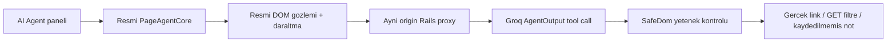

# LeadCurrent Phase 2 — Alibaba Page Agent

**Güncel finalizasyon:** [Veritabanını bilen Copilot ve Türkçe demo](COPILOT_PHASE2_FINAL_TR.md); aşağıdaki ilk Phase 2 kanıtları korunur.

**Phase 2.1 güncellemesi:** konuşmalı panel, doğrulanmış CRM cevapları, strict tool şeması ve adaptif pacing artık [AI Copilot teknik raporunda](COPILOT_PHASE21_TR.md) açıklanır. Aşağıdaki Phase 2 mimari/test sonuçları başlangıç sürümünün tarihsel kanıtıdır; eski 25 saniye bekleme ve ham aktivite sunumu güncel tasarım değildir.

20 Ekim 2026. Yerel `phase2/page-agent` dalı; baseline `65bcd55cfbd55ca1d91691bb1d873e0560fd76b0`. **Bu phase GitHub'a push edilmez ve Railway'e deploy edilmez.** Phase 1 üretim uygulaması ve kanıtları korunur. Özgün Phase 2 talebi ve ölçülmüş sonuçlar [CHALLENGE_LOG.md](../CHALLENGE_LOG.md) sonundadır.

## Resmî kütüphane ve mimari

Npm'den tam sürümle kurulan `@page-agent/core@1.12.4` ve `@page-agent/page-controller@1.12.4` kullanılır; `package-lock.json` transitif sürüm/integrity değerlerini kilitler. `zod@4.5.1` peer dependency, `esbuild@0.25.12` yalnızca derleme aracıdır. React, extension, yeni Ruby gem'i veya veritabanı migration'ı eklenmedi.

Kaynaklar: [Alibaba repository](https://github.com/alibaba/page-agent), [dokümantasyon](https://alibaba.github.io/page-agent/), [PageAgentCore API](https://alibaba.github.io/page-agent/docs/advanced/page-agent-core/), [model gereksinimleri](https://alibaba.github.io/page-agent/docs/features/models/), [kapsam/SPA sınırlamaları](https://alibaba.github.io/page-agent/docs/introduction/limitations/). SPA belge sayfaları tarayıcıda render edildiğinden gerçek API ayrıca resmî repository'nin `packages/core/src`, `packages/page-controller/src`, `packages/llms/src` ve docs sayfalarının kaynaklarından, ardından kurulu npm paketinin tip/JS çıktısından incelendi. İncelenen upstream commit: `9eb6b6646500264d9034dd466a4270cb9fc1ef1e`.

`PageAgentCore.execute(task)` gerçek observe → model → tool → observe döngüsünü yürütür. Gerçek `PageController` mevcut DOM'u çıkarır; dokümante edilmiş `transformPageContent` yalnızca izinli, görünür kontrollerin etiketlerini/filtre seçeneklerini, kayıt başlıklarını ve ekranda gösterilen durum/deadline bilgisini bırakır. `customTools` ile orijinal tehlikeli/genel araçlar kaldırılır ve aşağıdaki denetlenen DOM araçları eklenir. Bu bir kelime → URL chatbot'u değildir: rota seçimi yapan görev anahtar-kelime kodu yoktur; model gözlenen gerçek kontrol token'larını seçer.



`customFetch` yalnızca `/agent/chat/completions` Rails endpoint'ine session cookie + CSRF token ile POST yapar. Browser'a sağlayıcı anahtarı verilmez. Rails `PageAgent::Protocol` model/payload boyutu/mesaj biçimini doğrular, client sistem talimatını ve tool şemasını kendi sabit güvenli tanımıyla değiştirir. Ayrı `PageAgent::GroqClient`, sabit HTTPS Groq Chat Completions endpoint'ini kullanır ve doğrulanmış `AgentOutput` function çağrı kimliği/adı/JSON argümanlarını OpenAI-compatible yanıt olarak döndürür. Sağlayıcıda hiçbir araç çalıştırılmaz; izinli DOM eylemi tarayıcıda çalışır.

Phase 1 `Ai::GroqClient` değiştirilmedi: `tool_choice: none` ve strict satış tavsiyesi şeması aynı kaldı. Phase 2 yalnızca `openai/gpt-oss-20b`, named `AgentOutput`, `parallel_tool_calls=false`, `stream=false`, `max_completion_tokens=1024`, düşük reasoning effort kullanır. [Groq tool-use belgesi](https://console.groq.com/docs/tool-use/overview) bu modelin local tool desteğini belirtir; gerçek uyumluluk kontrolü 20 Ekim'de named function yanıtıyla geçti. Başka bir sağlayıcıya veya ücretli API'ye geçilmedi.

## Kodla uygulanan Safe Mode

| Araç | İzin verilen gerçek arayüz işlemi |
|---|---|
| click_control | Aynı origin allowlist'li CRM okuma linki veya GET `.filters` formunun Filter düğmesi |
| choose_option | Görünür arama filtrelerindeki izinli seçenek; owner için All owners / Me |
| fill_field | GET search alanı veya mevcut müşteri sayfasında kaydedilmeyen note body alanı |
| done | Sonuç bildirimi; tek başına herhangi bir CRM işlemi yapmaz |

Araçlar LLM'nin verdiği URL, CSS selector veya JavaScript'i çalıştırmaz. Token → mevcut DOM element Map'i her adımda yenilenir. Bağlantı origin/path/query allowlist'i, formun gerçek GET method/action/alanları, hedefin türü/görünürlüğü/halen bağlı oluşu eylem anında yeniden kontrol edilir. `/settings`, password, login/logout, new/edit ve tüm mutation linkleri yoktur. POST submit düğmeleri, stage/owner/task değişiklikleri, conversion, contact kaydı, silme ve mesaj gönderme için bir yetenek verilmez. `execute_javascript`, serbest click/input/select, scroll, wait ve ask_user araçları kaldırılır; deneysel script/llms.txt özellikleri kapalıdır. Modelin var olmayan bir kontrol veya yasak araç istemesi durdurulur.

GET formunda button/input `formmethod`, `formaction`, `formtarget` override'ları ve başka target varsa form reddedilir; linklerde legacy `data-method` de engellenir. Son canlı demodan sonra eklenen bu dar savunma, model yanıtı beklenirken Filter düğmesi POST'a çevrilse bile submit olayının oluşmadığını doğrulayan gerçek browser regression ile ayrıca kontrol edilir.

Note hazırlığı yalnızca kullanıcıya zaten sunulan `.action-form` body alanına yazabilir: Activity **Add a note** yapılır, isteğe bağlı follow-up tarihi temizlenir, form **submit edilmez**. Böylece hazırlanmış not daha sonra kaydedilirse yanlışlıkla tamamlanmış contact veya planlı task olmaz. Kullanıcı notu gözden geçirip gerçek **Save action** düğmesine kendisi basar. Terminal/okuma yetkili meslektaş kaydında note formu yoksa hazırlama yeteneği de yoktur. Rails tenant/owner/workflow korumaları aynen çalışır; agent özel sunucu yazma endpoint'i kullanmaz.

Mevcut kaydedilmemiş body metni varsa agent onu değiştirmez; modele yalnızca dolu/boş bilgisi verilir. “My” aramasında Owner=Me uygulanır; All owners bütün workspace anlamına gelir. Snapshot, seçili fakat henüz gönderilmemiş filtrelerden ayırt edilebilmesi için uygulanan URL'yi de gösterir. Filtreler birlikte seçilip tek GET submit ile uygulanabilir. Altı adım sınırına ulaşılması güvenli bir başarısızlıkla biter; modelin her çalıştırmada en kısa yolu bulacağı garanti edilmez.

Panel yalnızca normal authenticated CRM okuma sayfalarında vardır. Login, zorunlu parola değişimi, settings, password, new/edit sayfalarında gösterilmez. Proxy her istekte login/zorunlu-parola/CSRF kontrollerini uygular. Lead/opportunity page_path gönderildiğinde kayıt tekrar `WorkspaceAccess.scope` ile bulunur; cross-workspace kayıt 404 olur. Proxy şirket/müşteri geçmişi okumaz veya yazmaz.

## Mahremiyet, CSP ve bütçe

Model bütün DOM metnini almaz. `transformPageContent` gerçek çıkarmadan sonra izinli kontrol etiketlerine indirger; önceki notlar/aktiviteler, contact e-posta/telefon alanları, aktör bilgileri, hidden kayıtlar ve mevcut note input değerleri snapshot'a katılmaz. Query/başlık/görev metni yine hassas bilgi içerebilir; browser ve server e-posta, bazı telefon/credential biçimlerini en iyi çabayla maskeler. Bu tam anonimleştirme veya prompt-injection garantisi değildir. Model çıktısı/sonuç yalnızca textContent ile gösterilir; insan gözden geçirmelidir.

İstek gövdesi 28.000 byte, mesaj bütçesi 16.000 byte; DOM özeti 4.000 karakter, kullanıcı görevi ve note/input metni 600 karakter; sağlayıcı yanıtı 24KB, completion 1.024 token. En çok 6 model adımı; normal kullanımda adımlar arası 25 saniye beklenir. TLS peer doğrulaması, 3/15/5 saniye bağlantı/okuma/yazma ve 25 saniye toplam timeout; otomatik retry yoktur. Missing key/401/403/429/timeout/bozuk yanıt sabit güvenli mesajla gösterilir; ham sağlayıcı hata gövdesi tarayıcıya/log'a çıkmaz.

Agent dakikada 8/account, 12/workspace ve ortak Groq sayacında 16 istekte sınırlar; Phase 1 aynı provider sayacını en çok 20'ye kadar kullanabilir. İki AI yüzeyi aynı hesap için eşzamanlı isteği paylaşır. Agent ayrıca 24 saatlik TTL sayaçlarında 300/account, 600/workspace, 800/provider sınırı uygular. Bunlar process-local MemoryStore'dur, restart'ta sıfırlanır; çoklu worker/instance öncesi ortak store gerekir. İstek sayısı token kotasını garanti etmez; diğer kullanıcı/uygulamalar ve sağlayıcı limitleri nedeniyle yine 429 olabilir. Pacing kotayı garanti etmez.

CSP initializer değişmedi; unsafe-inline/unsafe-eval veya haricî CDN eklenmedi. Resmî kütüphanenin console/debugger çıktıları yerel bundle derlemesinde çıkarılır; prompt, müşteri içeriği ve model yanıtları loglanmaz. Zod `jitless` modu core import'undan önce ayarlanır; CSP altında eval probe yapılmaz. Kütüphanede kullanılmayan deneysel JS metodu bulunabilir ama araç haritasında erişimi yoktur ve CSP de dinamik eval'e izin vermez. Backend bildirimleri yalnızca model, sayısal token kullanımı ve allowlist'li eylem adını içerir; içerik/argüman yoktur.

## Turbo yaşam döngüsü

Panel `data-turbo-permanent` ile korunur. İzinli bir araç navigasyonu gerçek link/GET submit üzerinden Turbo'yu başlatır ve `turbo:load` tamamlanana kadar bekler; bir sonraki adım yeni DOM'u gözler. Stimulus reconnect/disconnect temizliği, tek event-listener seti, stop/dispose, değişen hedefin tekrar kontrolü ve body panel düzeninin korunması vardır. Kullanıcının beklenmeyen navigasyonu, güvenlik sayfasına geçiş ve pagehide task'ı durdurur. Full reload bilinmeyen görevi otomatik sürdürmez. Back/forward yeni görev başlatmaz. Extension veya çoklu tab kontrolü yoktur; non-Turbo/full document navigasyonunda devam garantisi verilmez.

## Kurulum ve demo

Node 22 ve mevcut Ruby/PostgreSQL ortamı gerekir. Yeni seed/reset yapmayın:

```powershell
Set-Location D:\LeadCurrent
npm ci --ignore-scripts
npm run build
powershell -ExecutionPolicy Bypass -File bin/local-postgres.ps1 -Action start
$env:GROQ_API_KEY = [Environment]::GetEnvironmentVariable('GROQ_API_KEY', 'User')
bundle exec rails server -b 127.0.0.1 -p 3100
```

http://127.0.0.1:3100 adresinde giriş yapın. Overview'de **AI Agent** açıp **Find my overdue leads.** yazın. Kayıt varsa gerçek overdue filtre/sonuç arayüzünü izleyin. Sonra **Open Atlas Industries.** diyerek görünür şirkete ait kaydı açtırın. Müşteri sayfasında **Prepare a follow-up note for this customer.** kullanın; agent yalnızca formu hazırlar. Metni ve Activity=Add a note seçimini kontrol ederek kendiniz Save action'a basın. Mevcut 24 saatlik kuralları değiştirmeden gerçek overdue veri yoksa mevcut kayıtları geçmişe taşımayın; aşağıdaki transaction'lı kurgusal demo script'ini kullanın.

Ek işler: opportunities listesinde negotiation filtresi, Tasks'ta today filtresi, Analytics'e navigasyon. Bunlar gerçek kontrollerle sınırlıdır; bilinmeyen müşteri uydurulmaz. Stop sonraki browser eylemlerini iptal eder; sunucuda başlamış Groq HTTP çağrısının tamamlanması/billing'i yine mümkün olabilir.

```powershell
bundle exec rails test
bundle exec rails test:system
bundle exec rails zeitwerk:check
bundle exec brakeman --no-pager --quiet
$env:RAILS_ENV = 'test'
$env:LEADCURRENT_LIVE_AGENT = '1'
bundle exec ruby script/verify_page_agent_tool_call.rb
bundle exec ruby script/verify_page_agent.rb
Remove-Item Env:LEADCURRENT_LIVE_AGENT
Remove-Item Env:RAILS_ENV
```

Normal CI/testler yalnızca transport'u mock eder; gerçek PageAgentCore, DOM extraction, Turbo ve form kontrolleri tarayıcıda çalışır. Model fixture'ı token'ı gerçek observation'dan seçer; kendisi browser'ı navigate etmez. Ayrı opt-in gerçek test üç senaryoda Groq kullanır, test PostgreSQL transaction'ında kurgusal Atlas oluşturup sonunda rollback yapar. CI/production'da çalışmayı reddeder. Gerçek/minimal test sonuçları ignored `.local/page-agent-compatibility.json` ve `.local/page-agent-live.json` altına, yalnızca ölçüldüyse usage ile yazılır. Browser testindeki ayrı Save action tıklaması agent aracı değil, test kullanıcısının manuel adımını temsil eder.

## Derleme, lisans ve dağıtım sınırı

`npm run build`, `app/javascript/page_agent/entry.js` üzerinden pinned resmî paketleri bundle eder. Propshaft build'i `app/assets/builds/page_agent.js` olarak aynı origin'den sunar; build çıktıları ve node_modules Git'e alınmaz. Ruby importmap/Turbo/Stimulus mimarisi korunur. CI, Node 22 ile npm ci/build çalıştırıp mevcut Rails/browser/security/assets kontrollerini sürdürür. Docker ayrı Node 22 build stage'inde bundle üretir; Ruby runtime image'a Node veya node_modules taşımaz. Render alternatifi de npm ci/build yapar ve Node 22 kurulu olmasını gerektirir.

Paketler MIT lisanslıdır. [Alibaba lisansı](../vendor/licenses/page-agent-LICENSE.txt), [browser-use atfı](../vendor/licenses/browser-use-NOTICE.txt), [Zod](../vendor/licenses/zod-LICENSE.txt), [Chalk](../vendor/licenses/chalk-LICENSE.txt) ve build aracı [esbuild](../vendor/licenses/esbuild-LICENSE.txt) notice'ları korunur. Runtime bundle lisans/atıf metinlerini taşır. Npm audit'in son gerçek sonucu challenge log'dadır; bu bir gelecekte açık olmayacağı garantisi değildir.

Bu Phase 2 dalı yayınlanmaz. Daha sonra onay verilirse Node build desteğiyle exact-commit CI, kaynak/secret taraması, mevcut Railway servisi ve gerçek public-URL kabul testleri ayrıca gerekir. Mevcut Railway Phase 1 Groq anahtarı dışında ek sağlayıcı hesabı istenmez; bu çalışma Railway değişkenlerini okumaz/değiştirmez.

## Son doğrulama

Normal testler **121 test / 1,776 assertion**, sıfır failure/error/skip ile geçti. Phase 1'in 100 testi korundu; 24/4/72 saat sınırları ve lead-to-Won akışı geçti. Autoload, production assets ve Brakeman (0 warning/error) geçti; npm audit 0 açık bildirdi. Kaynak/anahtar taraması, gerçek anahtarın source/bundle/test log'da bulunmadığını ve korunmuş Phase 1 kaynaklarını kontrol eder.

Gitleaks 8.30.1 kaynak snapshot taramasında iki eski false positive verdi: `docs/VERIFICATION_TR.md:39` public commit SHA ve `test/integration/authentication_test.rb:46` sentetik test parolası. İki dosya baseline'a göre değişmedi; yeni bulgu yok. Bu nedenle ham scanner çıkışı 1'dir; “sıfır bulgu” diye raporlanmaz. Doküman kontrolü 26 Markdown dosyasında yerel link/tablo/başlıkları, önceki 20 korunan dosyayı ve ignore/yerel master-key bütünlüğünü ayrıca doğruladı.

Gerçek named AgentOutput uyumluluğu geçti (632 ölçülmüş provider token). Son çok kullanıcılı gerçek browser demosu A/B/C **PASS**: Owner=Me + Overdue, Atlas kaydına gerçek Turbo linki ve kaydedilmemiş not; ardından ayrı test-kullanıcısı Save action ile yalnız note. **1 test / 34 assertion**, 11 gerçek completion, 13,873 provider token, 0 CSP ihlali. Bu ayrı kayıt tıklaması Capybara ile simüle edilmiş insan adımıdır, agent aracı değildir. [Kurgusal yerel browser görüntüsü](evidence/phase2-page-agent-2026-10-20.png), [ölçülmüş JSON kanıtı](evidence/phase2-page-agent-2026-10-20.json) ve [önceki başarısız denemeler dahil challenge kaydı](../CHALLENGE_LOG.md).

İlk canlı denemelerde yanlış niyet/navigasyon, kesin nedeni yakalanmayan hatalar ve altı adım sınırı görüldü; bir final assertion hatası cached association'dı ve düzeltildi. Bu sonuç her olası görevin başarı garantisi değildir. İnsan emeği, coding-agent tokenları ve ödenen maliyet ölçülmedi; provider sayıları yalnız belirtilen çalıştırmalara aittir. Docker Linux daemon erişimi yok, image build doğrulanmadı. Phase 2 remote CI/push/Railway deploy yapılmadı; yeni Phase 2 commit yoktur. Kod yerel dalda inceleme için bırakıldı.
